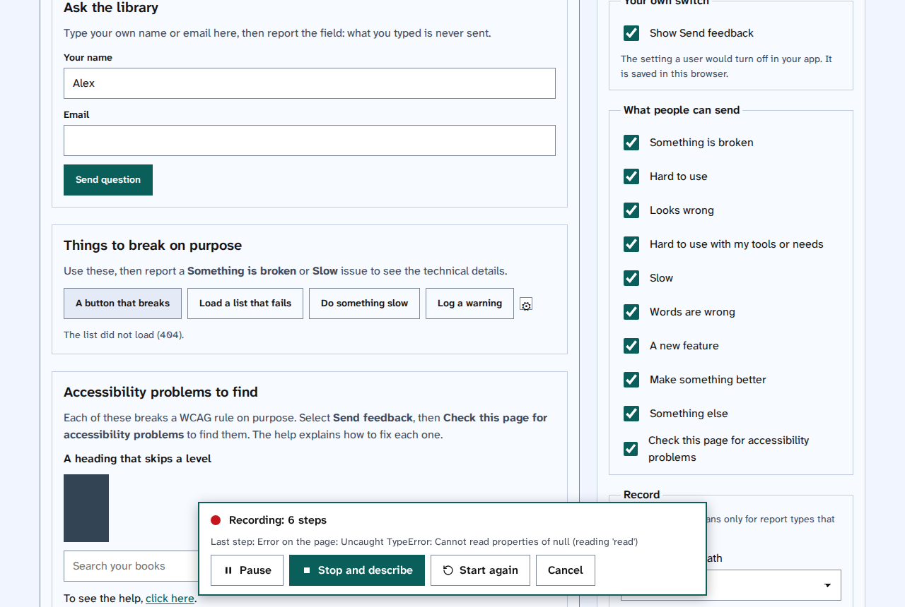
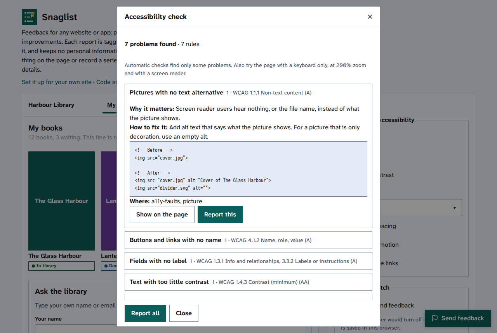

<picture>
  <source media="(prefers-color-scheme: dark)" srcset="docs/images/logo-wordmark-dark.svg">
  
</picture>

Feedback for any website or app. People report bugs and UX problems, suggest features and improvements, record a
series of steps, or check a page for accessibility problems. Each report is tagged with the page and the part of
it, carries the technical details needed to act on it, and keeps no personal information.

A snag list is a list of the small faults to fix before a job is finished. Snaglist adds a **Send feedback**
button to your site. People choose what to send, show one thing on the page or record what they do, answer a few
questions, check exactly what will be sent, and send it as a GitHub issue, an email or a post to your own server.

**[Try the demo](https://themightytrex.github.io/snaglist/)** ·
**[Set it up for your site](https://themightytrex.github.io/snaglist/configure.html)** ·
**[Help centre](docs/README.md)** · **[Prompts for AI assistants](docs/AI-PROMPTS.md)**


- **One file, no libraries:** about 100 KB, or 33 KB when your server compresses it. No build step.
- **Simple to add and to remove:** one script tag, or the [set-up tool](https://themightytrex.github.io/snaglist/configure.html)
  writes the code and one prompt for your AI assistant. Removing it leaves nothing behind.
- **Anonymous by design:** never what people type, no cookies, no query strings; emails, phone numbers,
  addresses and keys are replaced. People see the whole report before it goes, and can take parts out.
- **Accessible:** keyboard first, 44px targets, a visible focus ring, reduced motion, forced colours, and it
  follows the page's text size. Light by default, or dark, or the same as the device.
- **Any language:** British or US English built in; give your own text for any other language.

## What people can send

| Choice | Asks | Records for developers |
|---|---|---|
| Something is broken | What happened, what you expected | Text on screen, script errors with stack, console errors and warnings, failed and slow requests, steps before, the part's HTML |
| Hard to use | What is wrong | The part, text on screen, steps before |
| Looks wrong | What is wrong | Text on screen, styles and contrast, size and position, content cut off, what covers it, the part's HTML |
| Hard to use with my tools or needs | What is wrong, what you were using | Role, name, states, focus, target size, landmark, contrast |
| Slow | What is wrong, when | Load timings, LCP, CLS and INP, long tasks, script memory, slow requests |
| Words are wrong | What is wrong, a better wording | The part and its text |
| A new feature | What you would like, what it would help with, how you manage today | The page |
| Make something better | What could be better, your suggestion | The part |
| Something else | Your message | Nothing extra |
| Check this page for accessibility problems | Nothing: it runs an automatic check | Each problem, its WCAG criterion, where it is and how to fix it |

You choose what to offer and what each records. [Choose what people can send](docs/topics/choose-what-people-can-send.md)
and [What a report holds, and what it never holds](docs/topics/what-a-report-holds.md) have the details.

## Record a series of steps

For a problem that takes several steps, people select **A series of steps**, then **Start recording**, and use
the site as normal. **Pause**, **Start again** and **Stop and describe** are on the bar. Snaglist notes what they
select, change and send, the pages they go to, and any errors or failed requests, but never what they type. The
recording carries on across pages in the same tab.



## Check a page for accessibility problems

**Check this page for accessibility problems** runs 13 checks for the most common WCAG 2.2 failures, or axe-core
if you choose. Each problem says why it matters and how to fix it, with code before and after, and can be shown on
the page and reported on its own or with the rest.
[Fix common accessibility problems](docs/topics/fix-common-accessibility-problems.md) has every fix.



## Add it

The quickest way is the [set-up tool](https://themightytrex.github.io/snaglist/configure.html): choose what you
want, then copy the code, or one prompt that has your AI assistant add everything. By hand:

1. Copy `snaglist.js` into the folder your site serves files from.
2. Add one line before `</body>`, with the GitHub repository reports should go to:

   ```html
   <script src="/snaglist.js" data-github="owner/repo" defer></script>
   ```

   Or start it yourself, with any of the settings in the [settings reference](docs/topics/settings-reference.md):

   ```html
   <script src="/snaglist.js"></script>
   <script>
     Snaglist.start({
       app: "My app",
       language: "en-US",
       types: ["bug", "ux", "feature", "check"],
       send: { github: { repo: "owner/repo" }, email: { to: "team@example.com" } },
     });
   </script>
   ```

3. Add `data-component="checkout-summary"` to the main parts of your pages so reports name them, and
   `data-snag-private` to anything that shows personal details.

## Turn it on and off, or remove it

- **For everyone:** `enabled: false`, or start it only in test builds.
- **For each user:** give them a switch. `Snaglist.setUserEnabled(false)` hides the button and remembers the choice
  in that browser. Read [Add a switch for your users](docs/topics/add-a-switch-for-your-users.md).
- **Remove it:** delete the script tags and `snaglist.js`. `Snaglist.destroy({ forget: true })` removes it from a
  running page, puts back anything it wrapped, and clears its saved setting.

## Sending

| Way | How | Needs |
|---|---|---|
| GitHub | Opens a new issue with the title, report and labels filled in. The person posts it from their own account | A GitHub account for the person reporting |
| Email | Opens their mail app with the report filled in | A mail app |
| Your server | Posts the report as JSON, without cookies | An address that accepts it; [Send reports to your own server](docs/topics/send-reports-to-your-own-server.md) has an example that files GitHub issues for anyone |
| Copy and Download | Markdown on the clipboard, or a JSON file | Nothing |

No token or password is ever put in the page.

## Help

The [help centre](docs/README.md) has guides from start to finish and a topic for each task:

- [Add Snaglist to your site and get your first report](docs/guides/add-snaglist-to-your-site.md)
- [Set up Snaglist on your own server](docs/guides/set-up-snaglist-on-your-own-server.md)
- [Run a test session with Snaglist](docs/guides/run-a-test-session.md)
- [Find and fix accessibility problems](docs/guides/find-and-fix-accessibility-problems.md)
- [Send feedback on a site that uses Snaglist](docs/guides/send-feedback-on-a-site.md), for the people using it
- [Take Snaglist out of your site](docs/guides/take-snaglist-out-of-your-site.md)

Building with an AI assistant? The [set-up tool](https://themightytrex.github.io/snaglist/configure.html) writes one
prompt with your choices, [Prompts for AI assistants](docs/AI-PROMPTS.md) has more, and [llms.txt](llms.txt) is a
short summary written for AI tools.

## Part of a family

Snaglist began as the UX notes tool in the [design system](https://github.com/TheMightyTRex/design-system)
shared by [Storyarr](https://github.com/TheMightyTRex/storyarr) and
[Starboard](https://github.com/TheMightyTRex/starboard), and uses its design tokens when a page has them.

## Ideas for later

- A picture of the chosen part, opt-in, blurred outside it.
- Look for similar open issues before sending, to cut duplicates.
- Ready-made translations for the most used languages.
- Wrappers for React, Vue and WordPress.

## Licence

MIT. See [LICENSE](LICENSE). The flag and close icons are from [Lucide](https://lucide.dev) (ISC). The optional
axe-core engine is Deque's, under the Mozilla Public License 2.0, and is loaded only when chosen.
