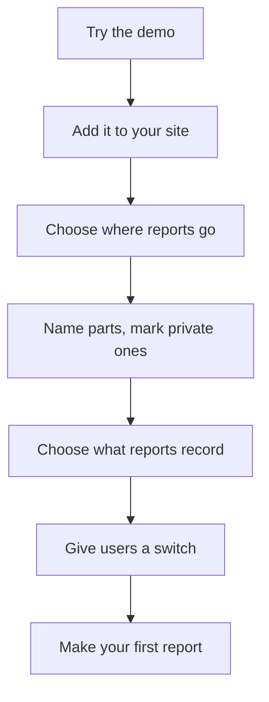

[Help centre](../README.md) · Guides

# Add Snaglist to your site and get your first report

For anyone who runs a website or app and wants people to report UX issues. At the end, every page has a
**Report an issue** button and your first report is in GitHub. It takes about 20 minutes.

## Before you begin

- You can change your site's files and publish them.
- A GitHub repository for the reports, or an email address.
- If you build with an AI assistant, it can do steps 2 to 5 for you: read
  [Use an AI assistant to add Snaglist](../topics/use-an-ai-assistant-to-add-snaglist.md).

## The steps at a glance

1. Try Snaglist on the demo page
2. Add it to your site
3. Choose where reports go
4. Name the parts of your pages and mark private ones
5. Choose what reports record
6. Give your users a switch
7. Make your first report

## Step 1: try Snaglist on the demo page

Open the [online demo](https://themightytrex.github.io/snaglist/) and report something on the made-up app,
to learn what your users will see. You know it worked when **What is sent** shows your report.

## Step 2: add it to your site

Download one file and add one line to your pages. Follow
[Add Snaglist to a website](../topics/add-snaglist-to-a-website.md), or
[Add Snaglist to a React, Vue, Svelte or other framework app](../topics/add-snaglist-to-a-framework-app.md).
You know it worked when **Report an issue** appears on your pages.

## Step 3: choose where reports go

Pick GitHub, email or your own server: [Send reports to GitHub](../topics/send-reports-to-github.md),
[Send reports by email](../topics/send-reports-by-email.md) or
[Send reports to your own server](../topics/send-reports-to-your-own-server.md).

## Step 4: name the parts of your pages and mark private ones

Give main parts a `data-component` name and mark anything personal with `data-snag-private`. Follow
[Name the parts of your pages](../topics/name-the-parts-of-your-pages.md) and
[Keep personal details out of reports](../topics/keep-personal-details-out.md).

## Step 5: choose what reports record

The defaults suit most sites. To change them, follow
[Choose what a report records](../topics/choose-what-a-report-records.md) and
[Choose the kinds of issue and how bad they can be](../topics/choose-the-kinds-of-issue.md).

## Step 6: give your users a switch

Let people turn the button off: [Add a switch for your users](../topics/add-a-switch-for-your-users.md).

## Step 7: make your first report

Report a real issue on your own site: [Report an issue on a page](../topics/report-an-issue.md). You know it
worked when the report is in your GitHub issues, inbox or server.

## What next

- [Run a test session with Snaglist](run-a-test-session.md)
- [Triage reports on GitHub](../topics/triage-reports-on-github.md)
- Share [Report issues on a site that uses Snaglist](report-issues-on-a-site.md) with the people who will report.
