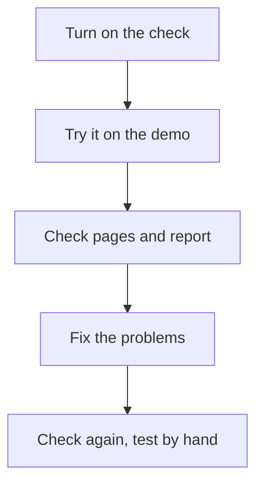

[Help centre](../README.md) · Guides

# Find and fix accessibility problems

For teams who want their site to meet WCAG 2.2 AA. At the end, the problems on your main pages are reported as
issues, fixed, and checked again. Allow an hour to set up and check your main pages, then the time to fix.

## Before you begin

- Snaglist is on your site: [Add Snaglist to your site and get your first report](add-snaglist-to-your-site.md).

## The steps at a glance

1. Turn on the accessibility check
2. Try it on the demo
3. Check each main page and report what it finds
4. Fix the problems
5. Check again, then test by hand

## Step 1: turn on the accessibility check

It is on by default. To choose axe-core for more rules, follow
[Turn on the accessibility check](../topics/turn-on-the-accessibility-check.md).

## Step 2: try it on the demo

Run the check on the [demo page](https://themightytrex.github.io/snaglist/), which has seven problems on
purpose: [Check a page for accessibility problems](../topics/check-a-page-for-accessibility-problems.md). You know
it worked when it lists seven problems.

## Step 3: check each main page and report what it finds

Run the check on each of your main pages and select **Report all**. Each report lists every problem, where it is
and how to fix it.

## Step 4: fix the problems

Follow [Fix common accessibility problems](../topics/fix-common-accessibility-problems.md), or give the reports to an
AI assistant with the prompt **Fix the accessibility problems Snaglist found** in
[Prompts for AI assistants](../AI-PROMPTS.md).

## Step 5: check again, then test by hand

Run the check again: you know it worked when it says no problems were found. Then do the checks it cannot do,
listed at the end of [Fix common accessibility problems](../topics/fix-common-accessibility-problems.md).

## What next

- Ask testers who use a screen reader, magnifier or voice control to try the site, and to report with
  **Hard to use with my tools or needs**.
