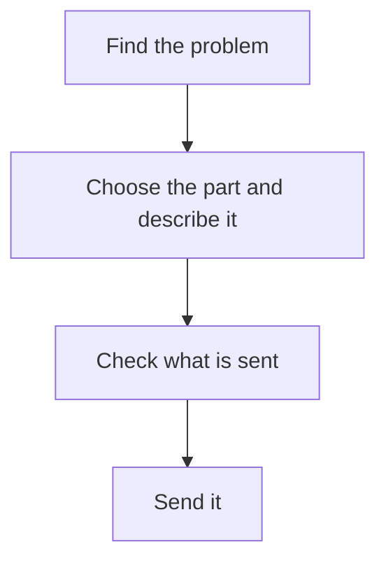

[Help centre](../README.md) · Guides

# Report issues on a site that uses Snaglist

For anyone asked to test a site or app, or who wants to tell its team about a problem. At the end, the team
has your report, tagged with the page and the part of it. Each report takes about 2 minutes.

## Before you begin

- The site has a **Report an issue** button on its pages.
- To send reports to GitHub, a GitHub account. Other ways need none.

## The steps at a glance

1. Find the problem
2. Choose the part and describe it
3. Check what is sent
4. Send it

## Step 1: find the problem

Use the site as you normally would. Anything wrong, confusing, slow or hard to use is worth reporting, as is
an idea.

## Step 2: choose the part and describe it

Follow [Report an issue on a page](../topics/report-an-issue.md). Say what you expected and what happened.

## Step 3: check what is sent

Read the whole report and untick anything you would rather not send:
[Check what is sent, then send it](../topics/check-what-is-sent.md). No personal information is kept in it.

## Step 4: send it

Choose one of the ways the site offers. For GitHub, read [Post a report on GitHub](../topics/post-a-report-on-github.md).
If it does not work, read [If a report does not send](../topics/if-a-report-does-not-send.md).

## What next

- [What a report holds, and what it never holds](../topics/what-a-report-holds.md)
- [Turn off Report an issue](../topics/turn-report-an-issue-off.md) when you have finished testing.
