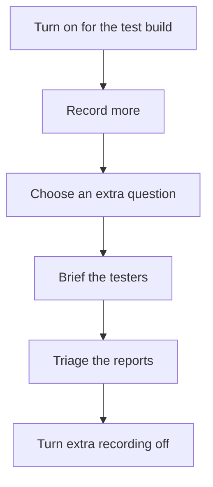

[Help centre](../README.md) · Guides

# Run a test session with Snaglist

For teams testing a new release or design with testers. At the end, every tester's issues are in GitHub,
tagged by page and component, sorted by how bad they are. Allow 30 minutes to set up, then the session itself.

## Before you begin

- Snaglist is on your site: [Add Snaglist to your site and get your first report](add-snaglist-to-your-site.md).
- A test build or staging site the testers can open.

## The steps at a glance

1. Turn Snaglist on for the test build only
2. Record more for the session
3. Choose an extra question for the session
4. Brief the testers
5. Triage the reports
6. Turn the extra recording off

## Step 1: turn Snaglist on for the test build only

Follow [Turn Snaglist on or off for everyone](../topics/turn-snaglist-on-or-off-for-everyone.md) and set
`enabled` from your build or a feature flag.

## Step 2: record more for the session

Offer more report types ([Choose the report types](../topics/choose-what-people-can-send.md)), and record the
technical details for every report with `collect: { styles: true, layout: true, errors: true, console: true }`:
[Choose what a report records](../topics/choose-what-a-report-records.md). Check your error and console messages
hold no personal details first.

## Step 3: choose an extra question for the session

Ask the extra question with `"heuristics"` for a usability review, `"wcag"` for an accessibility check, or your
own list:
[Choose the kinds of issue and how bad they can be](../topics/choose-the-kinds-of-issue.md).

## Step 4: brief the testers

Send them [Report issues on a site that uses Snaglist](send-feedback-on-a-site.md), the address of the test
build, and what to try. Ask for one report per problem.

## Step 5: triage the reports

Sort, reproduce and close: [Triage reports on GitHub](../topics/triage-reports-on-github.md).

## Step 6: turn the extra recording off

Set the `collect` settings back to `"auto"`, or turn Snaglist off, before the release goes live.

## What next

- [Remove Snaglist](../topics/remove-snaglist.md) if you only needed it for this release.
