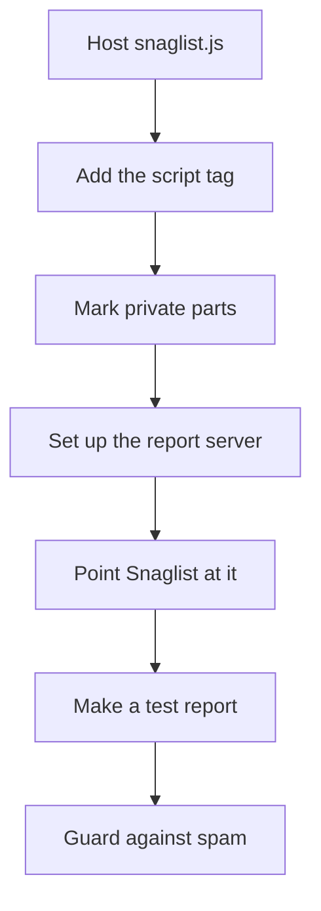

[Help centre](../README.md) · Guides

# Set up Snaglist on your own server

For site owners who want nothing loaded from anyone else, and reports from anyone, with or without a GitHub
account. At the end, your server hosts `snaglist.js` and takes reports, and files them as GitHub issues with a
key that never reaches the browser. It takes about 45 minutes.

## Before you begin

- A server that serves your site, and somewhere to run a small piece of server code, such as a Cloudflare
  Worker or your own app's server.
- A GitHub repository for the reports, and permission to make a token for it.

## The steps at a glance

1. Host the file on your server
2. Add it to your pages
3. Mark private parts of your pages
4. Set up the server that takes reports
5. Point Snaglist at your server
6. Make a test report
7. Guard against spam

## Step 1: host the file on your server

Download a fixed version and serve it with your other files. Follow
[Host Snaglist on your own server](../topics/host-snaglist-on-your-own-server.md). You know it worked when its
address opens the file in a browser.

## Step 2: add it to your pages

Add the script tag and a `Snaglist.start()` call: [Add Snaglist to a website](../topics/add-snaglist-to-a-website.md).

## Step 3: mark private parts of your pages

Follow [Keep personal details out of reports](../topics/keep-personal-details-out.md). This matters more when
anyone can report.

## Step 4: set up the server that takes reports

Run the example worker, or your own code, with a token that can only write issues in one repository. Follow
the example in [Send reports to your own server](../topics/send-reports-to-your-own-server.md).

## Step 5: point Snaglist at your server

Set `send: { endpoint: { url: "https://reports.example.com/" } }`. You can keep `github` as well, for people
who would rather post from their own account.

## Step 6: make a test report

Report something and select **Send**. You know it worked when Snaglist says "Report sent. Thank you." and the
issue appears in GitHub with its labels. If not, read [If a report does not send](../topics/if-a-report-does-not-send.md).

## Step 7: guard against spam

Add a rate limit on your report server, or start Snaglist only for signed-in users or in test builds:
[Turn Snaglist on or off for everyone](../topics/turn-snaglist-on-or-off-for-everyone.md).

## What next

- [Update Snaglist](../topics/update-snaglist.md) when a new version comes out.
- [Triage reports on GitHub](../topics/triage-reports-on-github.md)
