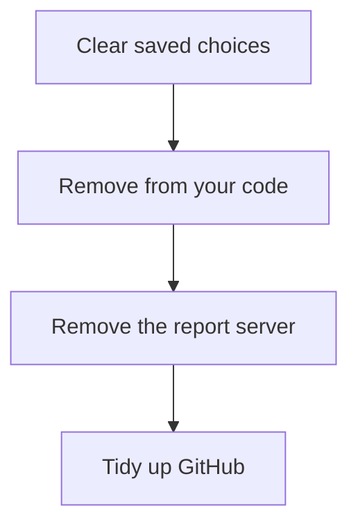

[Help centre](../README.md) · Guides

# Take Snaglist out of your site

For site owners who no longer need Snaglist. At the end, nothing of it is left in your code, your pages or
your users' browsers, and your past reports are kept. It takes about 15 minutes.

## Before you begin

- Decide whether to stop it for a while or remove it. To stop it, you only need
  [Turn Snaglist on or off for everyone](../topics/turn-snaglist-on-or-off-for-everyone.md).

## The steps at a glance

1. Clear people's saved choice (optional)
2. Remove Snaglist from your code
3. Remove the report server (if you set one up)
4. Tidy up GitHub

## Step 1: clear people's saved choice (optional)

Only people who turned the button off have anything saved: one small setting. To clear it, release one version
that calls `Snaglist.destroy({ forget: true })` on page load before you remove Snaglist.

## Step 2: remove Snaglist from your code

Follow [Remove Snaglist](../topics/remove-snaglist.md). You know it worked when the search in its step 5
finds nothing and **Report an issue** has gone.

## Step 3: remove the report server (if you set one up)

Delete the worker or server code from
[Send reports to your own server](../topics/send-reports-to-your-own-server.md), and revoke its GitHub token
in GitHub's settings for tokens.

## Step 4: tidy up GitHub

Keep the issues: they are your history. You can leave the `ux-report` labels, or delete them in **Issues**,
**Labels**.

## What next

- Add it back at any time: [Add Snaglist to your site and get your first report](add-snaglist-to-your-site.md).
