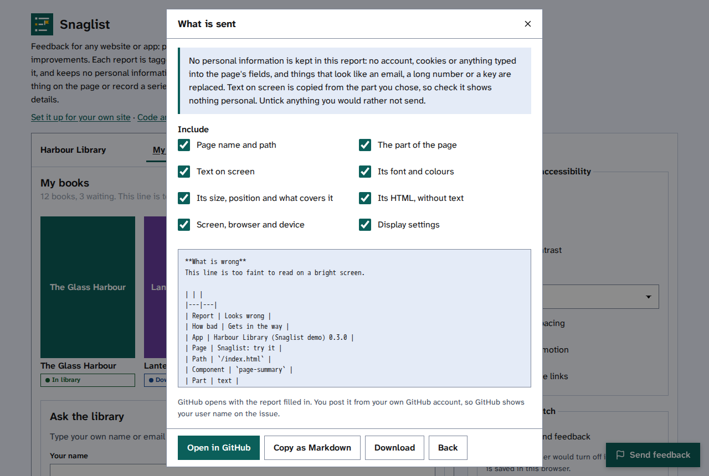

[Help centre](../README.md) · For people sending feedback · How-to

# Check what is sent, then send it

Before anything leaves your browser, Snaglist shows the whole report exactly as it will be sent. You can take
parts out, then choose how to send it.

## Before you begin

- Fill in the form first: [Report a problem with one thing on a page](send-feedback.md),
  [Record a series of steps](record-a-series-of-steps.md) or
  [Suggest a feature or an improvement](suggest-a-feature-or-improvement.md).

## Steps

1. Read the statement at the start of **What is sent**: no personal information is kept in the report.
2. Under **Include**, untick anything you would rather not send, such as **Text on screen** or **Screen,
   browser and device**. The preview changes at once.
3. Read the preview. Anything that looked like an email address, a long number or a key is shown as
   `[email]`, `[number]` or `[key]`. Check the text on screen shows nothing personal.

   

4. Choose how to send it. You will find only the ways the site's team has set up:
   - **Open in GitHub** opens a new GitHub issue with everything filled in. Read
     [Post a report on GitHub](post-a-report-on-github.md).
   - **Open in email** opens your mail app with a new message filled in. Send it as you would any email.
   - **Send** posts it straight to the site's own server. A message says when it has arrived.
   - **Copy as Markdown** puts the report on your clipboard, to paste anywhere.
   - **Download** saves the report as a file.
5. To change something first, select **Back**.

## If it does not work

Read [If a report does not send](if-a-report-does-not-send.md).

## Find out more

- [What a report holds, and what it never holds](what-a-report-holds.md)
