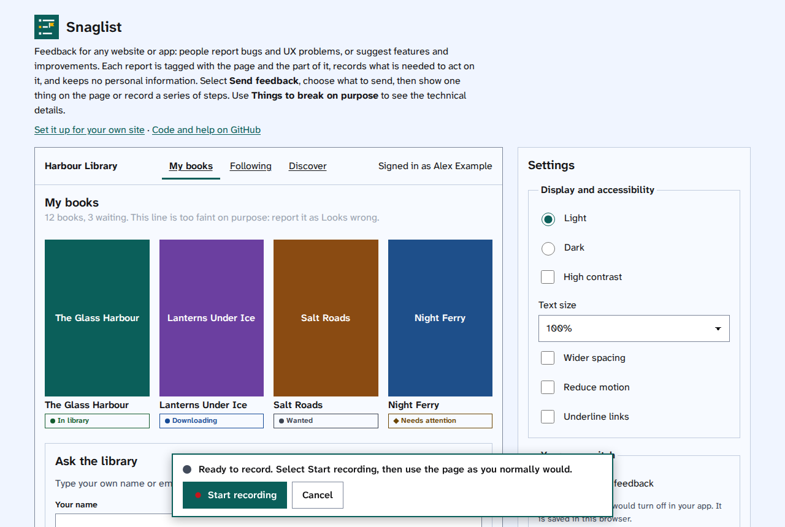
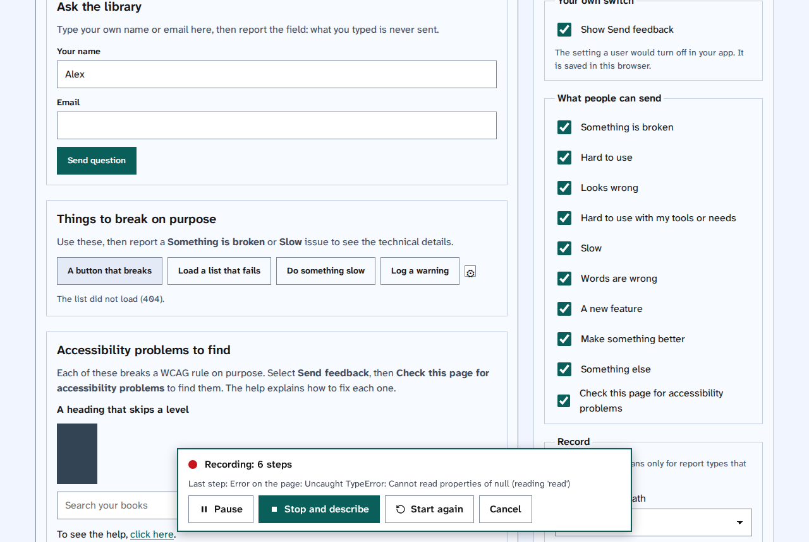
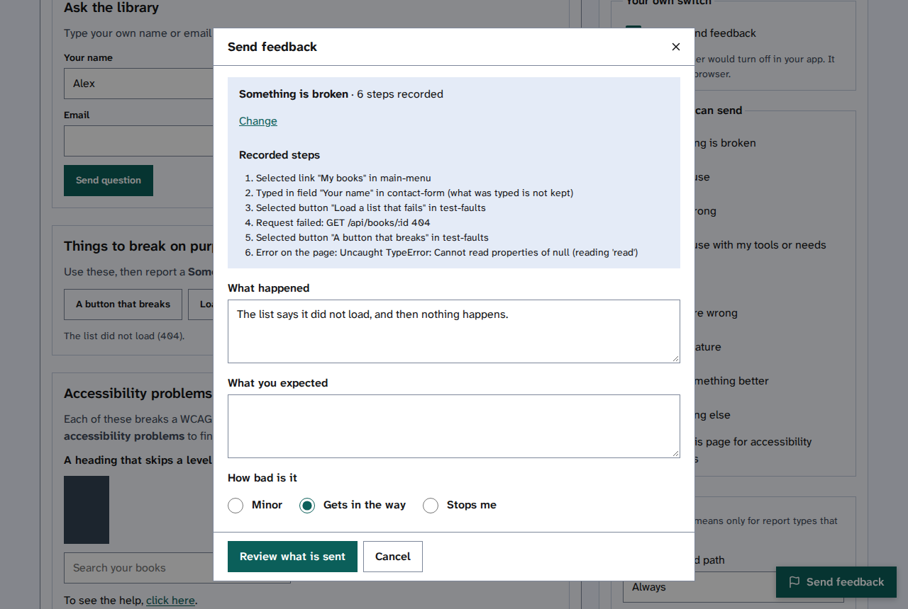

[Help centre](../README.md) · For people sending feedback · How-to

# Record a series of steps

When a problem only happens after several steps, record them. Snaglist notes each thing you select, change or
send, each page you go to, and any errors along the way, then you describe what went wrong.

## Steps

1. Go to the page where the steps start and select **Send feedback**.
2. Choose what you are reporting, such as **Something is broken**.
3. Under **What do you want to show**, choose **A series of steps**, then select **Continue**. A recording bar
   appears.

   

4. Select **Start recording**, then use the site as you normally would. The bar counts the steps and shows the
   last one.
   - To stop recording for a moment, select **Pause**. Select **Resume** to carry on.
   - To throw the steps away and begin again, select **Start again**.
   - To stop without sending anything, select **Cancel**.

   

5. When the problem has happened, select **Stop and describe**. The form opens with your recorded steps.
6. Select **Recorded steps** to check them, then say what happened and what you expected, and choose
   **How bad is it**.

   

7. Select **Review what is sent**, then read [Check what is sent, then send it](check-what-is-sent.md).

## Things to note

- What you type is never recorded. A step says "Typed in field Your name", not what you typed.
- The recording carries on when you go to another page on the same site, in the same browser tab. It stops
  when you close the tab.
- A recording keeps the last 60 steps.

## Find out more

- [Report a problem with one thing on a page](send-feedback.md)
- [What a report holds, and what it never holds](what-a-report-holds.md)
