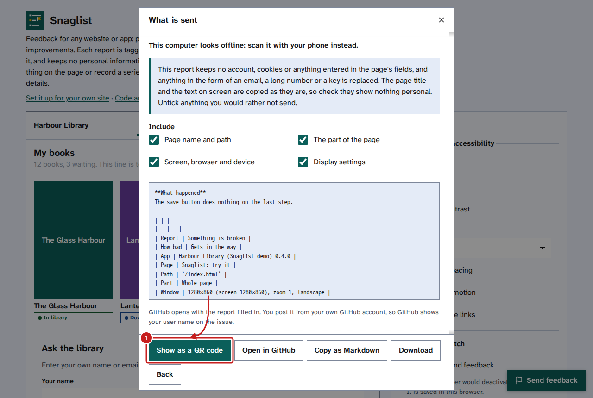
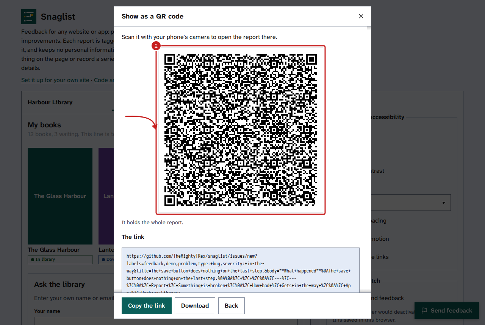
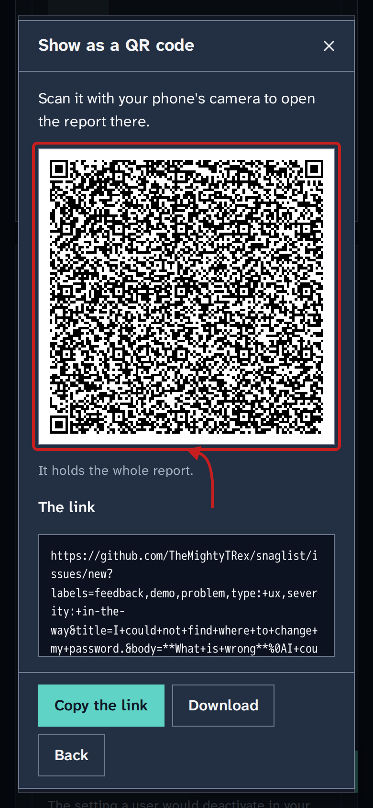

[Help centre](../README.md) · Sending feedback

# Send a report with a QR code

How-to

When the computer you are using is not online, such as one you are setting up, show the report as a QR code
and scan it with your phone. The phone opens the same new GitHub issue, filled in, for you to post from there.

## Before you begin

- Fill in the form and select **Review what is sent**: read [Check what is sent, then send it](check-what-is-sent.md).
- The site's team must send reports to GitHub. If there is no **Open in GitHub**, there is no QR code either.
- You need a phone with a camera that reads QR codes, and a GitHub account to post the issue.

## Steps

1. In **What is sent**, select **Show as a QR code**. When this computer looks offline, it is the first choice,
   with the reason above the privacy statement.

   

2. Point your phone's camera at the code, then open the link it finds. The new issue opens with the title,
   the report and the labels filled in.

   

3. Read the issue on your phone, then post it.
4. On the computer, select **Back** to return to **What is sent**, or close the window.

## Things to note

- A QR code holds less than a web address can, so a long report goes in shorter. The line under the code says
  what it holds: the whole report, the report without its technical details, a short report with your words
  cut to fit, or less. **Download**, when the site offers it, keeps the whole report, to add to the issue
  later.
- The code is never the only way. The link is shown as text under it, with **Copy the link**, and works on
  any device.
- The code is dark on light in every theme, so phones read it in dark mode too. Screen readers read a
  description of it, and the link as text.

  

- The code holds only what the preview in **What is sent** shows, never what you typed into the page.

## If it does not work

- **The phone does not find the code:** make the window larger, turn up the screen brightness, and hold the
  phone a little further away so the whole code, with its white edge, is in view.
- **The phone has no signal either:** select **Download** to keep the whole report, and send it later with
  **Copy as Markdown** or **Open in GitHub**.

## Find out more

- [Check what is sent, then send it](check-what-is-sent.md)
- [Post a report on GitHub](post-a-report-on-github.md)
- [If a report does not send](if-a-report-does-not-send.md)
