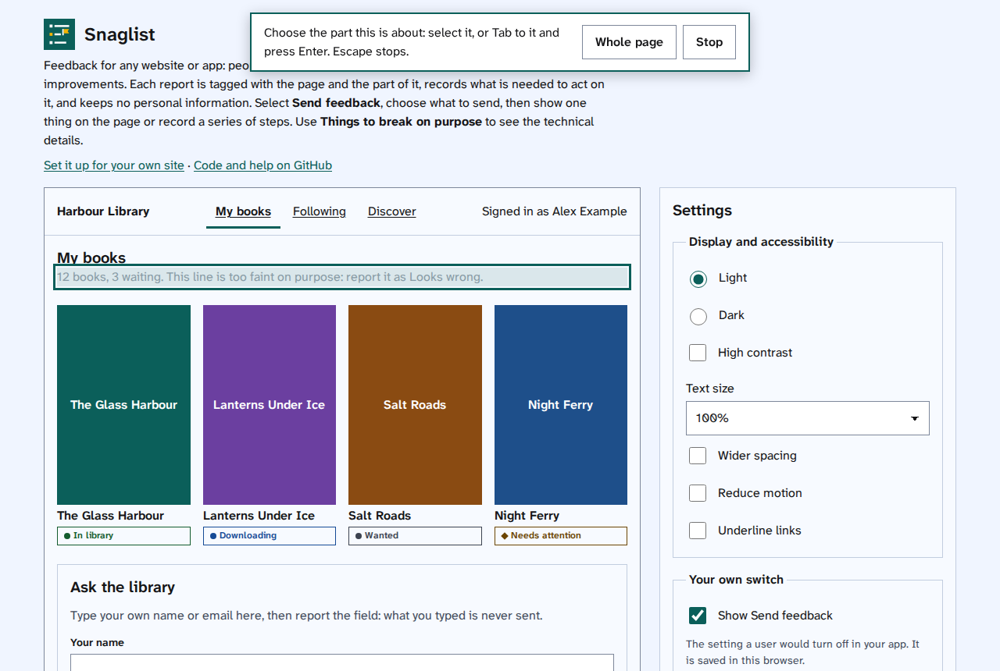
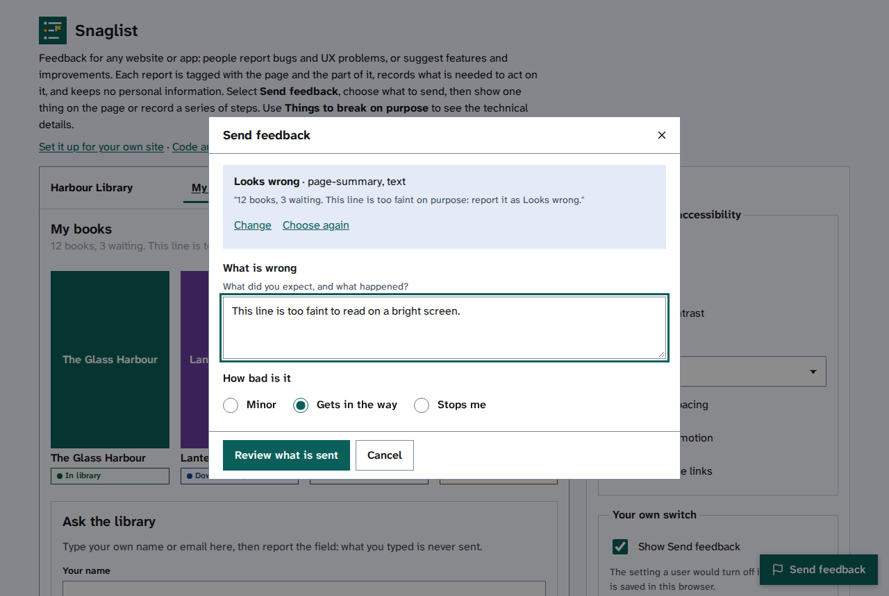

[Help centre](../README.md) · For people sending feedback · How-to

# Report a problem with one thing on a page

Tell the site's team about something on a page that is broken, confusing, slow or hard to use. You choose the
part of the page, say what is wrong, and check the report before it goes.

## Before you begin

- The site must have Snaglist turned on. You will find a **Send feedback** button on each page. If there is
  none, read [If Send feedback does not appear](if-send-feedback-does-not-appear.md).
- To show a problem that takes several steps, read [Record a series of steps](record-a-series-of-steps.md)
  instead. To suggest something, read [Suggest a feature or an improvement](suggest-a-feature-or-improvement.md).

## Steps

1. Go to the page with the problem and select **Send feedback**.
2. Under **Report a problem**, choose the one that fits best, such as **Something is broken**, **Looks wrong**
   or **Words are wrong**.
3. Under **What do you want to show**, choose **One thing on the page**, then select **Continue**.

   

4. Choose the part with the problem. A box shows what will be chosen.
   - With a mouse or touch screen, select the part.
   - With a keyboard, press Tab until the part is outlined, then press Enter.
   - For a problem with the page as a whole, select **Whole page**. To stop, select **Stop** or press Escape.

   

5. The form opens with what you are sending, where, and the text Snaglist copied from that part. To choose
   another part, select **Choose again**.
6. Say what is wrong, then choose **How bad is it**.

   

7. Select **Review what is sent**. Read [Check what is sent, then send it](check-what-is-sent.md) for the
   last step.

## Things to note

- Nothing you have typed into the page's own fields is ever read, so it is safe to report a form you have
  filled in.
- Snaglist copies the visible text of the part you chose, and any error or alert messages on the page, because
  they help the team find the problem. You can take them out before sending.
- One report per problem helps the team fix each one.

## Find out more

- [Record a series of steps](record-a-series-of-steps.md)
- [What a report holds, and what it never holds](what-a-report-holds.md)
- [Turn off Send feedback](turn-send-feedback-off.md)
