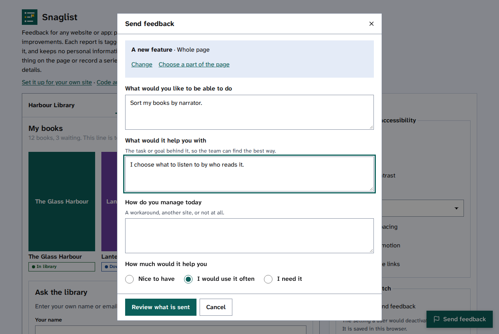

[Help centre](../README.md) · Sending feedback

# Suggest a feature or an improvement

How-to

Tell the site's team what would make it better: something new it cannot do yet, or a better way to do
something it already does.

## Steps

1. Select **Send feedback**.
2. Under **Make a suggestion**, choose one:
   - **A new feature**: something the site cannot do yet.
   - **Make something better**: an improvement to something that already works.
   - **Something else**: a question, a thank you, anything.
3. Under **What do you want to show**, choose **Describe it in words**, or **One thing on the page** if
   your suggestion is about a particular part. Then select **Continue**.
4. Answer the questions. For a new feature, say what you would like to do and what it would help you with:
   the task behind it helps the team find the best way.
5. Choose **How much would it help you**.

   

6. Select **Review what is sent**, then read [Check what is sent, then send it](check-what-is-sent.md).

## Find out more

- [Report a problem with one thing on a page](send-feedback.md)
