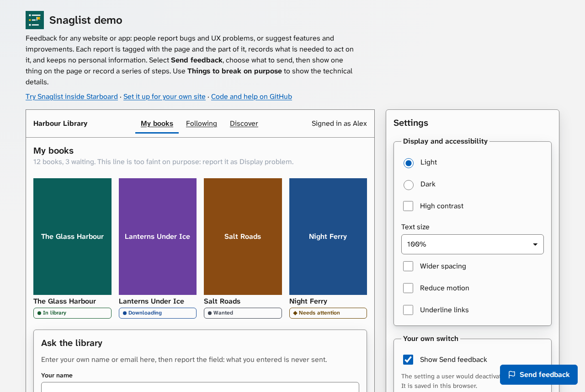
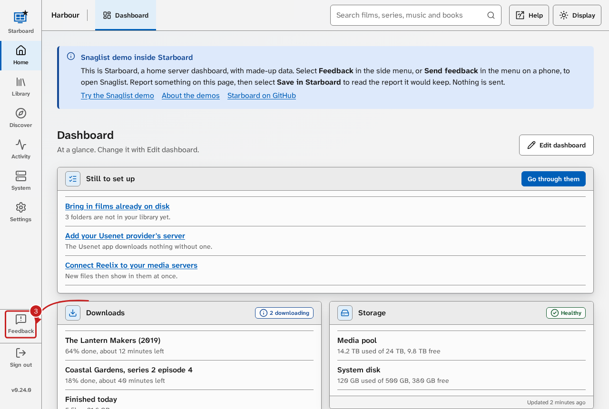
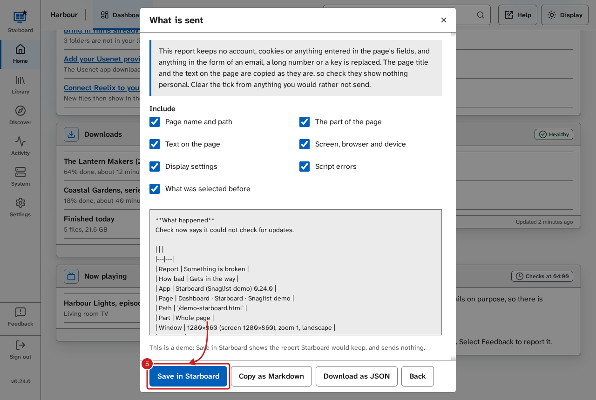
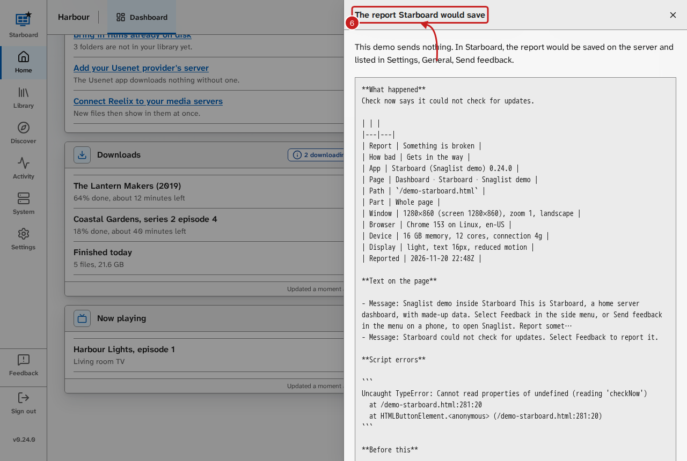

[Help centre](../README.md) · Before you add Snaglist
<!-- help: start / before -->

# Try the demos

How-to

Two demos show Snaglist working before you add it to your site. Both run in your browser, need no account and
keep no personal information. The first is a made-up app with every setting to try. The second is Snaglist
inside Starboard, a real app, set up the way Starboard sets it up.

## Before you begin

- A browser. Neither demo needs anything installed.

## Steps

1. To try every setting, open [the Snaglist demo](https://themightytrex.github.io/snaglist/) (opens in a new
   tab). It is a made-up library app, with **Send feedback** and **Settings** beside it. Change what people can
   send, what a report records and where it goes, then copy the code. **Things to break on purpose** gives you
   script errors, failed requests and a slow button to report.

   

2. To try Snaglist in a real app, open [Snaglist inside Starboard](https://themightytrex.github.io/snaglist/demo-starboard.html)
   (opens in a new tab). It is the Starboard dashboard, with made-up data. **Check now** on the **Updates** card
   fails on purpose, so there is a script error to report.
3. Select **Feedback** in Starboard's side menu. On a phone, select **Menu**, then **Send feedback**. Snaglist has
   no button of its own here: it opens from Starboard's menu, as it does in Starboard.

   

4. Choose what to send, describe it, then select **Review what is sent**.
5. Read the report, then select **Save in Starboard**.

   

6. Read the report Starboard would keep. In Starboard, it is saved on the server and listed in Settings,
   General, Send feedback.

   

## Things to note

- Snaglist inside Starboard sends nothing. **Save in Starboard** shows the report instead, and **Copy as
  Markdown** and **Download as JSON** work as they do on any site.
- Reports from the Snaglist demo go to the Snaglist repository on GitHub, with the `demo` label, from your own
  GitHub account. You check each one before it is posted.
- **Display**, in Starboard's header, changes the theme, and Snaglist changes with it.
- Starboard starts Snaglist with `launcher: false` and opens it with `Snaglist.open()` from its own menu item.
  Do the same to put **Send feedback** in your own menu.

## Find out more

- [Run the demo on your computer](run-the-demo-on-your-computer.md)
- [Add Snaglist to a website](add-snaglist-to-a-website.md)
- [Check what is sent, then send it](check-what-is-sent.md)
- [Starboard on GitHub](https://github.com/TheMightyTRex/starboard) (opens in a new tab)
