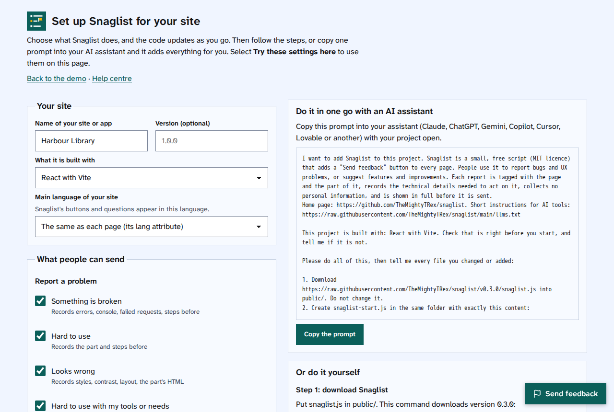

[Help centre](../README.md) · Add and set up · How-to

# Use the set-up tool

The set-up tool asks what you want Snaglist to do on your site, then gives you the files, the code, where each
piece goes, and one prompt that has an AI assistant add it all in one go.

## Steps

1. Open the [set-up tool](https://themightytrex.github.io/snaglist/configure.html) (opens in a new tab).
2. Under **Your site**, type its name and choose **What it is built with**, such as WordPress, React or plain
   HTML pages. The steps change to match.
3. Choose **What people can send**, **Where it goes**, **What reports record**, **Questions and ratings** and
   **When and how it shows**. The code updates as you go.

   

4. Select **Try these settings here** to try them on the set-up page itself.
5. Then either:
   - select **Copy the prompt** and paste it into your AI assistant with your project open, or
   - follow **Or do it yourself**: download `snaglist.js`, save your settings as `snaglist-start.js` in the
     same folder, add the two script lines where it says, and add the switch and labels if you chose them.
6. Open your site and select **Send feedback** to check it works.

## Things to note

- Your settings live in one small file, `snaglist-start.js`, next to `snaglist.js`. To change them later, edit
  that file, or make a new one with the set-up tool.
- Select **Copy a link to these settings** to save your choices, or share them with someone else.
- The set-up tool runs in your browser. Nothing you type in it is sent anywhere.

## Find out more

- [Add Snaglist to a website](add-snaglist-to-a-website.md)
- [Use an AI assistant to add Snaglist](use-an-ai-assistant-to-add-snaglist.md)
